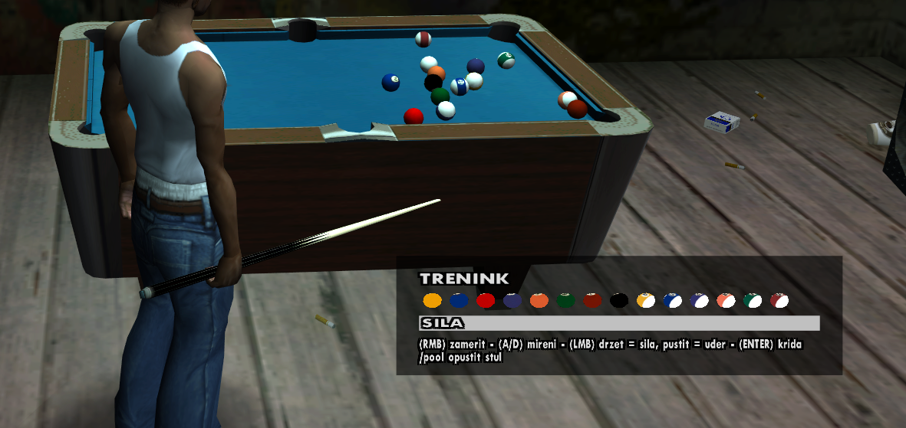

# rz-pool

Pool for SA-MP built on [physics.inc](https://github.com/uPeppe/physics.inc): practice alone, or play a two-player 8-ball match.

## Features

- **Practice mode** - anyone can join the table, every pocketed ball scores a point.
- **2-player 8-ball** - invite another player to a match. Simplified rules: open table after the break, solids / stripes, fouls, 8-ball win / loss, re-rack. The match result is announced to the whole server.
- **Info box** (bottom right): whose turn it is, remaining balls as 3D model previews, power bar and key guide.
- **Protection**: melee swings near the table are cancelled, balls can only be moved by a shot, players can't climb onto the table.
- **Customizable**: labels, colors and the UI layout can be changed by editing `pool.inc` (the texts are in Czech by default).
- Drop-in integration: one include, one function per main callback.

## Requirements

- SA-MP 0.3.7 or newer (model preview textdraws)
- [physics.inc](https://github.com/uPeppe/physics.inc) by Peppe and the includes it needs, `foreach` and `modelsizes` (see the [physics.inc forum thread](https://forum.open.mp/showthread.php?tid=641))
- A Pawn compiler (tested with pawncc 3.10)

## Installation

1. Copy `pawno/include/pool.inc` next to your other includes.
2. Make sure `physics.inc`, `foreach.inc` and `modelsizes.inc` are on the include path.
3. Call the pool functions from your callbacks (see below).

## Integration

See `gamemodes/pool.pwn` for a complete example. The callbacks that need to call into the library:

| Callback | Call |
|---|---|
| `OnGameModeInit` | `Pool_Init()` |
| `OnPlayerSpawn` | `Pool_OnPlayerSpawn(playerid)` |
| `OnPlayerDeath`, `OnPlayerDisconnect`, `OnPlayerInteriorChange` | `Pool_Leave(playerid)` |
| `OnPlayerKeyStateChange` | `Pool_OnPlayerKeyStateChange(playerid, newkeys, oldkeys)` |
| `PHY_OnObjectUpdate` | `Pool_OnObjectUpdate(objectid)` |
| `PHY_OnObjectCollideWithObject` | `Pool_OnObjectCollideWithObject(object1, object2)` |
| `PHY_OnObjectCollideWithWall` | `Pool_OnObjectCollideWithWall(objectid, wallid)` |

The `/pool` command exists only in the example gamemode. In your own gamemode, call `Pool_Command(playerid, params)` from any command you like.

## Controls

| Key | Action |
|---|---|
| RMB | start / stop aiming (stand next to the cue ball) |
| A / D | rotate the aim |
| LMB | hold to charge the power, release to shoot |
| SPACE | cycle cameras while aiming |
| ENTER | chalk the cue |

## Table location

Ten Green Bottles Bar (interior 11), around `510.11, -84.83, 998.87`.

## Configuration

All settings are the `#define`s at the top of `pawno/include/pool.inc`.

## Credits

- [physics.inc](https://github.com/uPeppe/physics.inc) and the original pool demo by Peppe.

## License

[GPL-3.0-or-later](LICENSE), the same license as physics.inc, which this project builds on.
